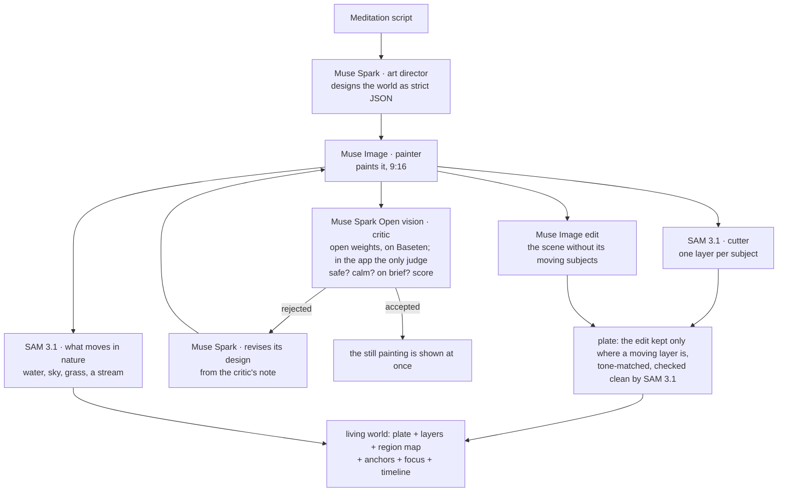

# ELYND Worlds


**Every meditation opens on a living painted world: one of 459 that Meta's models painted for the library, or a new
one painted live for a very personal meditation, designed, painted, checked and brought to life with Meta's models.**

[ELYND](https://elynd.app) writes and voices a new guided meditation for each listener, every time. ELYND Worlds,
built during the Meta Global AI Developer Hackathon (Startup track, *Build for Your World*), gives each of those
meditations a place you can see: a calm painting that fits the meditation and lives as such a place would.
Its water ripples, its clouds drift, its grass waves, a lantern flickers, and the objects in it move as such
things move. It greets you as you arrive, fades while your eyes are closed, returns in long silences and at the
end, and stays with you afterwards as a card you can share.

> **What existed before, what is new.** ELYND, the meditation app (writing, voices, player), existed before
> the hackathon. Earlier on the kickoff day we tried the Meta Model API in a separate private
> prototype. This repository was started from scratch after the kickoff (26 Oct 2026, 12:00 ET) and
> contains none of that prototype's code: everything here was written during the hackathon.
>
> **Open-source parts it uses** (installed, not copied here): the OpenAI Python SDK (Apache-2.0; Meta Model API
> speaks its wire format), httpx (BSD-3-Clause), Pillow (MIT-CMU), NumPy (BSD-3-Clause), Meta's meta-sam-parser
> (SAM License) for SAM 3.1's answers, pytest (MIT) and pytest-asyncio (Apache-2.0), Flutter (BSD-3-Clause), and
> the Poppins font (SIL Open Font License 1.1, bundled).

## How a world is made

One agent run per meditation, four Meta models, one of them open weights:



| Step | Model | What it does |
|---|---|---|
| Art director | `muse-spark-1.3` | Reads the meditation and designs one world in strict JSON: place, light, palette, air, 1–3 solid foreground subjects (what each is: a thing, or an animal or a person only when the meditation itself brings one; how it is attached, how it moves, whether it glows), what moves in nature (water, sky, grass, a stream, trees), what drifts through the air (leaves, snow, pollen, fireflies) and the painting prompt. It is told never to copy the listener's words and never to add an animal or a person of its own: the world is the place alone. No picture carries text. |
| Painter | `muse-image-1.0` | Paints the world, portrait for a phone. Built-in web search and shell are off. The prompt ends with a style line that names the animals and people the design brings, asleep or lying at rest, and forbids any other; every other world is painted as the place alone. Told how to paint people and animals at rest in any world, Muse Image put a figure nobody designed into every painting we checked (8 of 8) and refused half the requests of the latest wording; told "no people and no animals", it added none and refused none (4 of 4; 29 Oct 2026). |
| Critic | `meta-models/muse-spark-open-1026` (Muse Spark Open, open weights, served by Baseten; vision) | Looks at every painting before a listener does: a person or an animal the design does not bring, one drawn wrong or awake, a face up close, text, anything unsettling, on brief, a 0–10 score, and a one-sentence fix. It sees only the painting and the scenery design, never the meditation or the listener. If it fails, takes longer than 18 s or answers out of shape, `muse-spark-1.3` on Meta Model API judges instead, except where the deployment lets only the open model judge (`open_critic_only`): the ELYND app does, so a painting it cannot check is never shown and the library world stays. On our six example worlds both agreed on every safety check, and both rejected the test pictures that must fail (a face up close, a sign with letters, a storm). |
| Revision | `muse-spark-1.3` | A rejected painting goes back to the art director with the critic's note, and the agent paints once more (two paintings at most). |
| Cutter | `sam-3.1` | Cuts each designed subject out as its own layer: asks name and plural at once, keeps only the near instances, fills holes, and records the outline box. A layer is opaque two pixels past the outline, so it carries the subject's own soft edge; a floating boat's outline is closed over its oars, which then ride with it. |
| What moves | `sam-3.1` | Finds the water, the sky, the grass and a stream the design names, one request each, and packs them into one region map the phone's shader reads; still subjects are taken out of it, so a stone in a lake never ripples. A glowing subject becomes a light that flickers. |
| Plate | `muse-image-1.0` edit + `sam-3.1` | Repaints the scene without the moving subjects; the repaint is used only where a moving layer is opaque, colour-matched to its surroundings, and SAM checks that no moving subject is left. Otherwise a local fill there. A still subject (a stone, a post) stays exactly as painted, and with nothing moving no repaint is asked for. At rest, plate and layers equal the painting. |

The critique, the cutting, the repaint and the search for what moves only need the painting, so they run at the
same time; a rejection cancels the others. The still painting is shown as soon as the critic accepts it (21–70 s
after the script is written in our runs; the slower ones were made six at a time), and the living world follows
(59–104 s).

## A world from the first second: the library

A world made for a meditation takes about a minute and costs about five cents, and most meditations visit
places a library can hold. So the same agent painted a **library** in advance: 500 worlds of the 90 places guided
meditations visit most, each at several times of day, seasons or weathers, 75 of them dark worlds for falling
asleep, and 20 more that give an unmotivated listener a push (a path leading on, steps toward the light, a pass
at sunrise), all from `scripts/library_briefs.py` and each checked by the critic like any other. Only worlds that
look alive stay (`library.looks_dead`: water, a stream, a field, swaying crowns, rain, snow, leaves or petals, a
moving subject, or a sky wide or starry enough to carry the world; `scripts/library_audit.py`), and every figure
and post was looked at up close: **459 worlds**, 70 for sleep (`library/catalog.json` lists them).

**What each world helps with.** Muse Spark looked at every painting (`library.tag_moods`, 384 px, one world a
request) and named the one to three feelings it helps with, best first: calm, letting go, warmth, rest, a push,
joy, reflection, clarity, strength. These are the categories ELYND's background music is chosen by, with joy kept
apart from the push: a happy listener and an unmotivated one hear the same lifting music, but a sleepy beach
motivates no one. Read from the designs alone, every world sounded soft ("a quiet ridge", "a slow river"); only
the paintings told a summit at sunrise from a sunny garden.

**Which world a meditation opens on.** By default, ELYND's own server chooses, and nothing is sent anywhere
(`library.local`): the place the meditation names (in English, German, Spanish or French, German compounds by
their last part), else the listener's feeling, the same way the music is chosen; fit first, then never a world
seen in the last ten meditations while one that fits as well is fresh. A sleep meditation gets a sleep world.

With **personal worlds**, which a listener turns on, Muse Spark reads the meditation instead (`library.pick`, at
most its first 600 words, minimal reasoning, a prompt-cache key per use: about a third of a cent), names the three
library worlds that fit best and says whether the meditation is built around something no library world shows: a
particular animal or object that matters to the listener, a particular person's place, an unusual setting.

* **It fits:** the library world is the session's world, on screen within seconds. Nothing is painted.
* **It is very personal:** the library world shows at once, a world is painted for the meditation, and it takes
  its place in one slow cross-fade when complete; if painting fails, the library world stays.
* **Muse Spark cannot or must not answer:** the server's own choice. There is always a world.

```bash
.venv/bin/python scripts/library_briefs.py                     # library/briefs/*.txt (500 themes)
.venv/bin/elynd-worlds make library/briefs/*.txt --out library/worlds --parallel 4
.venv/bin/elynd-worlds pick my_meditation.txt --library library/catalog   # what a meditation would get
.venv/bin/python scripts/library_audit.py                      # which library worlds would look dead
```

## On the phone

`flutter/elynd_worlds_scene` draws a world in a Flutter app:

* **A living painting.** A fragment shader (`shaders/living.frag`) reads the region map and moves each part as it
  moves in nature: ripples travel over the water towards the viewer and its reflections wobble, now and then the
  sun glints on it; the clouds drift; waves of wind roll through the grass; a stream flows; the crowns sway; a
  lantern flickers and its light with it. Leaves, snow, pollen or fireflies drift through the air.
* **Life passes through.** Now and then a small flock or a few gulls cross the sky, a fish rises on still water,
  stars twinkle and a faint shooting star falls, rain rings the water, petals drift, cloud shadows slide over a
  meadow: each only where it belongs, decided from the design (`life.py`).
* **Objects move as such things move.** A boat sinks a little on the swell, rises back to where it is painted and
  rolls; something in the air floats on a slow loop and a butterfly folds its wings now and then; plants sway
  in gusts about where they grow; mist drifts. Stones, posts and cabins stay still. Nothing grows or shrinks.
* **Eyes closed.** A per-second timeline follows the session: the whole world while the listener arrives
  (45 s), a glow while their eyes are closed, more of it in long silences, all of it at the end. Sleep worlds
  stay dim and end dark. The phone's (Dart) and the browser's (JavaScript) timelines are tested frame by frame
  against the Python one.
* **Time passes in the place too.** The light changes slowly over the session, so the listener sees it when
  their eyes open at the end: a morning world's sun climbs, a golden-hour world's glow deepens, a sleep world
  dims and keeps its light warm (low, warm light before sleep: Brown et al., PLoS Biology 2022). It starts
  exactly as painted, and the picture is blended toward the light rather than brightened, so no highlight burns
  out (`light.dart`; the browser uses the same numbers).
* **Phones crop.** Each world has a focus point (where its subjects are); the painting is cropped around it,
  and subjects painted too low are lifted above the player's controls with a small zoom.
* Reduce-motion is respected: the world then only fades.
* **Battery.** The scene is redrawn at most 30 times a second, 15 while it is only a glow, never at the display's
  60 or 120; a locked screen draws nothing. A world is about 190 KB to download.

## Privacy and safety

* Opt-in for Meta. Every meditation opens on a library world chosen on ELYND's own server, and nothing is sent
  for that. Nothing reaches Meta until a listener turns on personal worlds, on a screen that says plainly what is
  sent to whom (a one-time card on the home screen, or the switch in Profile, which also turns it off again). The
  server records that consent before it asks Meta anything.
* In ELYND, only the written meditation goes to Meta, with its technique, language and length: no name, no
  email, no mood, no account id.
* Standard mode only. The package refuses `-contributor` models, which may train on what they receive.
* `store: false` on every Muse Spark and SAM request (the Responses API stores requests by default), and a
  pseudonymous listener id (a keyed hash Meta cannot reverse) so that any abuse enforcement targets one
  listener, not the whole app.
* A world shows the place alone unless the meditation itself brings an animal or a person (the listener's dog,
  asleep). Then only those, asleep or lying at rest and painted naturally, a person small and seen from behind,
  never a face up close or a figure looking at the viewer. The critic checks every painting and turns away any
  other figure; no picture contains text.
* The critic on Baseten receives the painting and its scenery design only: no meditation, no listener id.
* Every picture a listener sees or shares is marked as made by AI in its metadata (the IPTC digital source
  type `trainedAlgorithmicMedia` that Muse Image puts on its paintings). The plate, the layers and the share
  card keep the mark (EU AI Act, Art. 50).

## Cost

Every step reports its usage to a meter priced with the published rates. A world costs about **$0.06**
($0.050–0.063 in our last six): two Muse Spark calls, two Muse Image pictures (one when nothing in it moves)
and a handful of SAM images. When Muse Spark Open judges, its share (half a cent to a cent) is Baseten's bill:
the meter keeps the two bills apart. The command line refuses to run past a budget and stops asking the open
model at a budget of its own; the ELYND backend stops making worlds at a total and a daily cap.

## Open weights for the thinking, too

The critic already runs on Muse Spark Open. With `--open-designer` the open model also designs each world and
revises it from the critic's note, so everything but the painting and the cutting runs on open weights. Tested on
20 new meditations in four languages (28 Oct 2026), each painted by Muse Image and judged by both models:

| Designer | Score from Muse Spark | Score from Muse Spark Open | Design time (median) | Designed |
|---|---|---|---|---|
| Muse Spark, the model decides how long it thinks | 8.85 / 10 | 8.60 / 10 | 14.5 s | 20 of 20 |
| Muse Spark Open, reasoning low | 8.94 / 10 | 8.78 / 10 | 4.8 s | 18 of 20 |
| Muse Spark, reasoning low (the default since) | 8.95 / 10 | 8.75 / 10 | 6.4 s | 20 of 20 |

So the open model's worlds score as well with either judge, and it designs three times as fast. The same test showed
that Muse Spark needs no long thinking either: with reasoning low it designs as well, in less than half the time. Its host
enforces no answer shape (one design came back without a title) and its filter refused one calm meditation (a
desert under the stars), so the engine asks it once more when an answer is out of shape and lets Muse Spark
design whenever it cannot. On the six example meditations a whole world cost $0.040 instead of $0.055.

In the ELYND app the open model judges but does not design. A listener's meditation can carry what they shared
about their health, and Baseten's standard data terms exclude health data unless a separate agreement covers it
(its Data Processing Addendum, 15 Sep 2026, Annex A), so listeners' meditations go only to Meta, whose models they
agreed to. Muse Spark Open sees only the painting and a short description of the place. Library worlds grow from
our own short texts about a place, never from a listener's meditation, so the open model can design those.

## See it in a browser

`web/` is a gallery of worlds the agent made for the example meditations. They live as they do on the phone:
the page compiles the phone's own shader for WebGL 2 and uses the same motion. **Play as a meditation** runs a
session sped up (arriving, eyes closed, a long silence, the end), and each world shows how the agent made it: the
design, the critic's score, the layers, what moves, the time and the cost. **Open it at
https://heynomads.github.io/elynd-worlds/web/**, nothing to install; or serve the repository and open `/web/`:

```bash
python -m http.server 8000          # then http://localhost:8000/web/  (web/parity.html: the timeline check)
.venv/bin/python scripts/web_gallery.py out/<time>/<name> ...   # rebuild web/worlds/ from saved runs
```

## Run it

Without any account or key: the recorded worlds in the browser (https://heynomads.github.io/elynd-worlds/web/,
or locally as below; each with the design, the critic's verdict,
the layers, the time and the cost of how the agent made it), and the tests, which run the whole agent loop against
a fake Meta Model API.

```bash
python -m http.server 8000          # then http://localhost:8000/web/
python -m venv .venv && .venv/bin/pip install -e ".[dev]"
.venv/bin/pytest                    # no network, no key
```

With a Meta Model API key, the agent makes new worlds:

```bash
export MODEL_API_KEY=...            # a Meta Model API key
export OPEN_MODEL_API_KEY=...       # optional: Muse Spark Open on Baseten as the critic
.venv/bin/elynd-worlds make examples/lake_visualization.txt   # writes out/<time>/<name>/world.json + pictures
.venv/bin/elynd-worlds sheet out/<time>                         # a contact sheet
.venv/bin/elynd-worlds make examples/*.txt --open-designer   # Muse Spark Open designs too (needs its key)
```

To watch a world move without a phone:

```bash
cd flutter/elynd_worlds_scene
flutter test test/render_preview_test.dart --dart-define=WORLD_DIR=/abs/out/<time>/<name> \
  --dart-define=FRAMES_DIR=/abs/frames --dart-define=SILENT=true
ffmpeg -framerate 30 -i /abs/frames/%04d.png -pix_fmt yuv420p preview.mp4
```

## Layout

```
elynd_worlds/          the engine (Python)
  art_director.py      Muse Spark designs and revises
  painter.py           Muse Image paints and repaints without the subjects
  critic.py            Muse Spark Open (or Muse Spark) judges each painting
  library.py           the library: Muse Spark's choice, the server's own choice (by place or feeling),
                       each world's feelings tagged by sight, and which worlds look dead
  life.py              what lives in a world: birds, stars, fish, rain, petals, cloud shadows
  cutter.py            SAM 3.1 cuts the layers
  regions.py           SAM 3.1 finds the water, sky, grass and a stream
  plate.py             the clean plate behind the moving layers
  director.py          the agent loop
  timeline.py          how much of the world shows over the session
  card.py              the share card
  loop.py              a world's 12 s that loop without a seam (the shared clip), music bed and AI mark
  meta.py              the clients, privacy fields, cost meter
flutter/elynd_worlds_scene/   the scene on the phone (Dart, and the living painting's shader)
web/                   the scene in a browser (JavaScript, WebGL 2) and the gallery
scripts/               the gallery builder; replate.py rebuilds saved worlds' plates offline;
                       library_briefs.py writes the library's themes
library/briefs/        the library's 520 themes (the pictures are kept out of git; catalog.json lists the 459)
examples/              example meditations written for this repository
tests/                 against a fake Meta Model API
docs/                  the picture at the top of this page
```

## Licence

Apache License 2.0 (`LICENSE`), © 2026 Comads OÜ. The bundled Poppins fonts are under the SIL Open Font
License 1.1 (`elynd_worlds/fonts/OFL.txt`).
