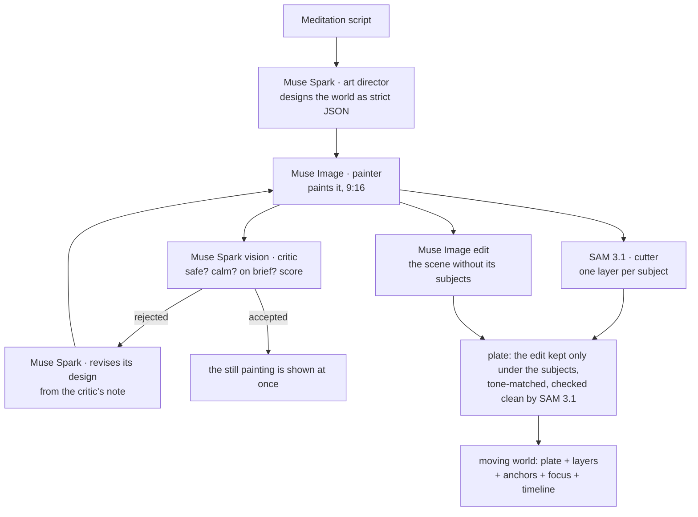

# ELYND Worlds

**Every meditation gets its own painted world, designed, painted, checked and brought to life with Meta's models.**

[ELYND](https://elynd.app) writes and voices a new guided meditation for each listener, every time. ELYND Worlds,
built during the Meta Global AI Developer Hackathon (Startup track, *Build for Your World*), gives each of those
meditations a place you can see: a calm painting made from the meditation itself, whose foreground objects are
cut out and move gently with the session. It greets you as you arrive, fades while your eyes are closed, returns in
long silences and at the end, and stays with you afterwards as a card you can share.

> **What existed before, what is new.** ELYND, the meditation app (writing, voices, player), existed before
> the hackathon. Earlier on the kickoff day we tried the Meta Model API in a separate private
> prototype. This repository was started from scratch after the kickoff (26 Oct 2026, 12:00 ET) and
> contains none of that prototype's code: everything here was written during the hackathon.

## How a world is made

One agent run per meditation, four Meta models:



| Step | Model | What it does |
|---|---|---|
| Art director | `muse-spark-1.3` | Reads the meditation and designs one world in strict JSON: place, light, palette, air, 1–3 solid foreground subjects (how each is attached and moves), and the painting prompt. It is told never to copy the listener's words, and no picture carries text. |
| Painter | `muse-image-1.0` | Paints the world, portrait for a phone. Built-in web search and shell are off. |
| Critic | `muse-spark-1.3` (vision) | Looks at every painting before a listener does: people or faces, text, anything unsettling, on brief, a 0–10 score, and a one-sentence fix. |
| Revision | `muse-spark-1.3` | A rejected painting goes back to the art director with the critic's note, and the agent paints once more (two paintings at most). |
| Cutter | `sam-3.1` | Cuts each designed subject out as its own layer: asks name and plural at once, keeps only the near instances, fills holes, and records the outline box. |
| Plate | `muse-image-1.0` edit + `sam-3.1` | Repaints the scene without the subjects; the repaint is used only under each subject's outline, colour-matched to its surroundings, and SAM checks that no subject is left. Otherwise a local fill. |

The critique, the cutting and the repaint only need the painting, so they run at the same time; a rejection
cancels the other two. The still painting is shown as soon as the critic accepts it (about 35 s after the
script is written; 21–43 s in our runs), and the moving world follows (about 70 s; 59–89 s).

## On the phone

`flutter/elynd_worlds_scene` draws a world in a Flutter app:

* **Calm, natural motion.** Things move only as they would: stones and posts stay still, a boat rises and falls a
  little on the water and rolls a little, something in the air makes a slow loop, plants sway in a light wind about
  where they grow, mist drifts. Nothing ever grows or shrinks. The whole world drifts like a very slow camera, near
  layers a little more than the clean plate behind them: depth, which is what the cut-out layers are for.
* **Eyes closed.** A per-second timeline follows the session: the whole world while the listener arrives
  (45 s), a glow while their eyes are closed, more of it in long silences, all of it at the end. Sleep worlds
  stay dim and end dark. The phone's (Dart) and the browser's (JavaScript) timelines are tested frame by frame
  against the Python one.
* **Phones crop.** Each world has a focus point (where its subjects are); the painting is cropped around it,
  and subjects painted too low are lifted above the player's controls with a small zoom.
* Reduce-motion is respected: the world then only fades.

## Privacy and safety

* Opt-in. Nothing reaches Meta until a listener turns Painted worlds on, on a screen that says plainly
  what is sent to whom (a one-time card on the home screen, or the switch in Profile, which also turns it
  off again). The server records that consent before it paints anything.
* In ELYND, only the written meditation goes to Meta, with its technique, language and length: no name, no
  email, no mood, no account id.
* Standard mode only. The package refuses `-contributor` models, which may train on what they receive.
* `store: false` on every Muse Spark and SAM request (the Responses API stores requests by default), and a
  pseudonymous listener id (a keyed hash Meta cannot reverse) so that any abuse enforcement targets one
  listener, not the whole app.
* No picture contains people, faces or text; the critic checks every painting.
* Every picture a listener sees or shares is marked as made by AI in its metadata (the IPTC digital source
  type `trainedAlgorithmicMedia` that Muse Image puts on its paintings). The plate, the layers and the share
  card keep the mark (EU AI Act, Art. 50).

## Cost

Every step reports its usage to a meter priced with Meta's published rates. A world costs about **$0.05**:
two Muse Spark calls, two Muse Image pictures and a handful of SAM images. The command line refuses to run
past a budget, and the ELYND backend stops making worlds at a total and a daily cap.

## See it in a browser

`web/` is a gallery of worlds the agent made for the example meditations: they move as they do on the phone,
**Play as a meditation** runs a session sped up (arriving, eyes closed, a long silence, the
end), and each world shows how the agent made it: the design, the critic's score, the layers, the time and the
cost. Serve the repository and open `/web/`:

```bash
python -m http.server 8000          # then http://localhost:8000/web/  (web/parity.html: the timeline check)
.venv/bin/python scripts/web_gallery.py out/<time>/<name> ...   # rebuild web/worlds/ from saved runs
```

## Run it

```bash
python -m venv .venv && .venv/bin/pip install -e ".[dev]"
export MODEL_API_KEY=...            # a Meta Model API key
.venv/bin/elynd-worlds make examples/lake_visualization.txt   # writes out/<time>/<name>/world.json + pictures
.venv/bin/elynd-worlds sheet out/<time>                         # a contact sheet
.venv/bin/pytest                                                # tests, no network
```

To watch a world move without a phone:

```bash
cd flutter/elynd_worlds_scene
flutter test test/render_preview_test.dart --dart-define=WORLD_DIR=/abs/out/<time>/<name> \
  --dart-define=FRAMES_DIR=/abs/frames --dart-define=SILENT=true
ffmpeg -framerate 30 -i /abs/frames/%04d.png -pix_fmt yuv420p preview.mp4
```

## Layout

```
elynd_worlds/          the engine (Python)
  art_director.py      Muse Spark designs and revises
  painter.py           Muse Image paints and repaints without the subjects
  critic.py            Muse Spark vision judges each painting
  cutter.py            SAM 3.1 cuts the layers
  plate.py             the clean plate behind them
  director.py          the agent loop
  timeline.py          how much of the world shows over the session
  card.py              the share card
  meta.py              the client, privacy fields, cost meter
flutter/elynd_worlds_scene/   the scene on the phone (Dart)
web/                   the scene in a browser (JavaScript) and the gallery
examples/              example meditations written for this repository
tests/                 against a fake Meta Model API
```

© 2026 Comads OÜ.
